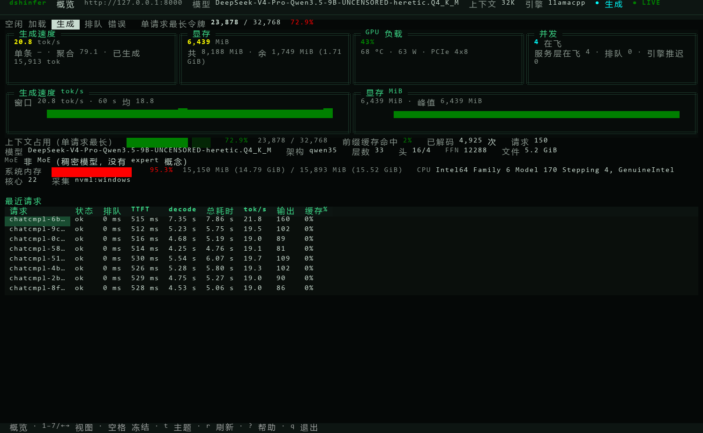
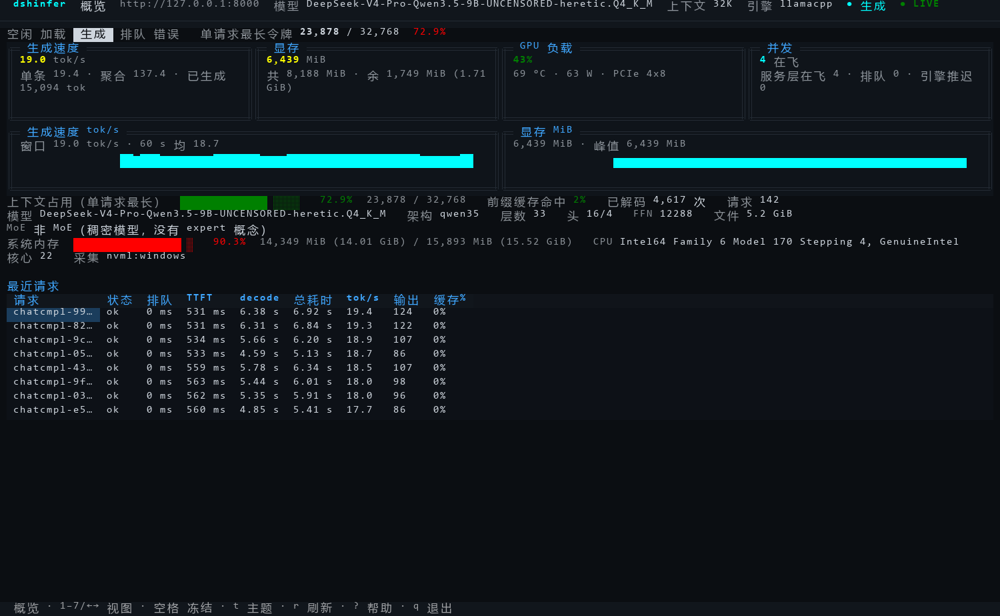
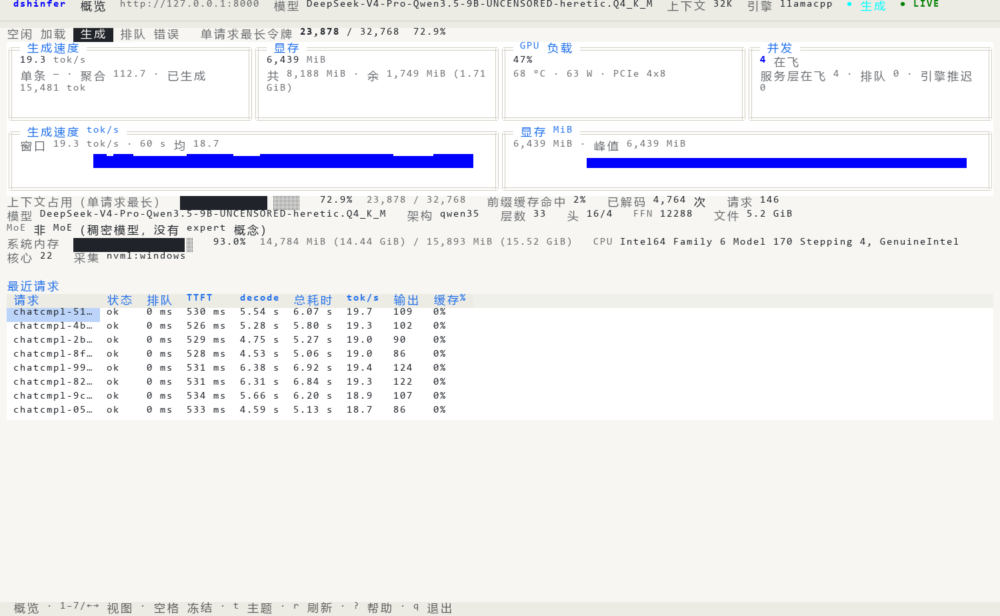
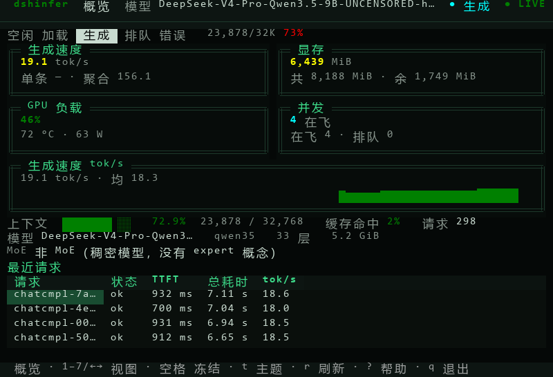
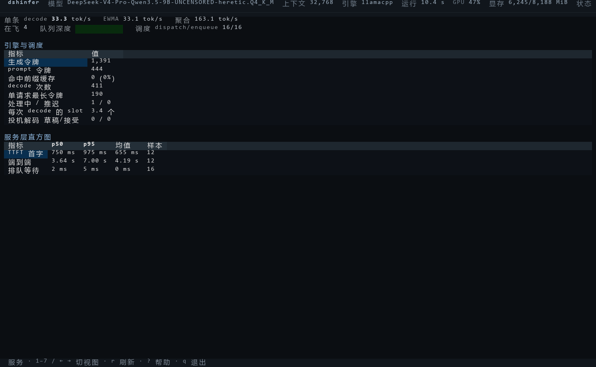
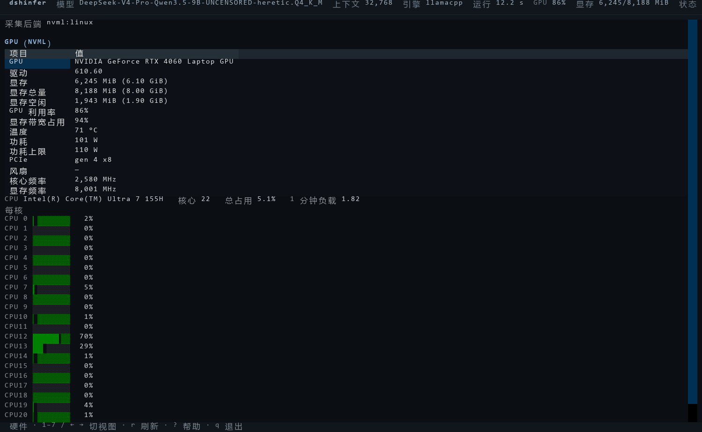

# 终端面板（TUI）

目标：不开浏览器、不开端口、不装 Grafana，直接在本机终端里看这套推理服务到底在干什么——
生成速度、显存、GPU、队列、单请求时间线、引擎原始指标、日志。

实现：Python + [Textual](https://textual.textualize.io/)（终端 UI 框架），
```
src/dshinfer/tui/
    __init__.py    入口（延迟 import，缺依赖时只报一句人话）
    __main__.py    CLI：--snapshot / --dump-env / --monitor / 向导
    probe.py       系统原生采集：NVML（Win/Linux）+ CPU + 内存；永远不抛异常
    live.py        三路数据源合成一个 Snapshot + 引擎速率差分 + GGUF 头
    preset.py      预设（JSON）+ compose 环境变量片段 + 容器内路径自适应
    wizard.py      启动向导（10 步，单屏重绘）
    monitor.py     监视器（7 视图）
    widgets.py     Kpi / Spark / 条形 / 表格填充等小组件
    app.tcss       样式（暗色、窄边框）
```

## 0. 长什么样

150×44 终端、4 并发在跑、本机实测（真 pty 录屏回放出的图，出图方法见 §9）：



同一屏的三套配色（`t` 键循环，默认黑绿）：

| 黑绿（默认） | 暗蓝 | 浅色 |
| --- | --- | --- |
|  |  |  |

80×26 紧凑布局（宽度 < 100 列自动切：KPI 两列、只留一条曲线、请求表 5 列）：



服务视图（引擎原始指标 + 服务层延迟直方图）：



硬件视图（NVML 全量 + 每核 CPU）：



## 1. 怎么跑

三种跑法，选一种：

```bash
# ① Windows 原生（不依赖 WSL）：本机 python + uv
uv run --extra tui python -m dshinfer.tui            # 向导 → 监视器
uv run --extra tui python -m dshinfer.tui --monitor  # 跳过向导，用最近一次预设直接看

# ② WSL 里原生跑（服务还没进容器时）
cd ~/infer && uv run --extra tui python -m dshinfer.tui --monitor

# ③ 容器里跑（推荐：引擎的 /metrics 只绑容器内 127.0.0.1，宿主看不到）
bash docker/ops.sh tui
```

第 ③ 种是历史上能看到**引擎侧指标**的方式（当时引擎还是独立进程，监听 `127.0.0.1:8124`）；
没有发布到宿主，只有和它同 netns 的面板能抓 `/metrics`。宿主上看盘时引擎那一栏会写
「引擎指标读不到」——这是刻意的提示，不是 bug。

几个非交互用法（给脚本/CI 用，不需要终端）：

```bash
# 打一次完整 JSON 快照（数据层通不通一看就知道；有 errors 时 exit 1）
uv run --extra tui python -m dshinfer.tui --snapshot

# 打印这份预设对应的配置片段（env_file 形式，含容器内路径）
uv run --extra tui python -m dshinfer.tui --dump-env

# 上面那条去掉容器路径（导出本机 D:\\ 路径版本）
uv run --extra tui python -m dshinfer.tui --dump-env --local-env

# 用指定预设
uv run --extra tui python -m dshinfer.tui --preset ~/.config/dshinfer/presets/32k.json --monitor
```

## 2. 启动向导（10 步）

按键每一屏都一样：**↑↓ 选择 · Enter 确认 · Esc 返回（第一屏是退出）· ? 解释这一屏 · q 退出**。
问号浮层里写的是「这一屏到底在问什么」以及这台机器上的实测数字（不是泛泛的解释）。

| # | 步骤 | 改什么 | 落地到 |
| --- | --- | --- | --- |
| 1 | 预设 | 沿用当前值 / 读已有预设 / 用默认值重开 | — |
| 2 | 模型 | 从模型目录里选 GGUF（含 `draft/` 子目录），或手动输入路径 | `model_file` |
| 3 | 模型文件夹 | 引擎扫描 `*.gguf` 的目录 | `models_dir` |
| 4 | 上下文 / KV | 8K / 16K / 32K / 64K（q8_0）+ 32K（f16） | `n_ctx` `cache_type_k/v` |
| 5 | 图片 | mmproj 投影文件；没有就「不使用」 | `mmproj` |
| 6 | 并发 | 1 / 2 / 4 / 8（同时设引擎 slot 与服务层并发） | `n_parallel` `max_concurrency` |
| 7 | 调优 | balanced(2048/1024) / conservative(512/512) / prefill(4096/2048) | `n_batch` `n_ubatch` |
| 8 | 高级 | 服务日志路径（引擎在服务进程内，只有这一份日志） | `service_log_path` |
| 9 | 访问 | 仅本机 127.0.0.1 / 局域网 0.0.0.0 / 自定义 host:port | `host` `port` |
| 10 | 保存 | 命名 + 保存并启动监视器 / 只保存 | 落两份文件 |

保存会写两份文件（用户要求「向导要真落地」，不是只存在内存里）：

```
# Windows: %APPDATA%\\dshinfer\\presets\\       （可用 DSHINFER_PRESETS_DIR 覆盖）
# Linux/WSL: ~/.config/dshinfer/presets/
<name>.json     预设本体（字段与 Settings 一一对应）
<name>.env      可直接当 env_file 用，或整段贴进本机 .env（键名与 Settings 字段一致）
```

第 10 屏会把 `problems()`（跑不起来的问题，红字）与 `warnings()`（能跑但有代价的，
比如 64K 掉速 35%、并发大于 slot）分开列出来——**有问题也能保存**，只是先告诉你。

## 3. 监视器（7 视图）

启动后 `1`–`7` 或 ←/→ 切视图，`空格` 冻结画面（服务照跑），`t` 换配色，`r` 立即刷新，
`?` 键位，`q` 退出（会问「后台继续跑还是停掉」）。

| 键 | 视图 | 看什么 |
| --- | --- | --- |
| 1 | 概览 Overview | 生成速度（大字 tok/s + 单条/聚合）、显存 used/总 + 余量、GPU 利用率/温度/功耗/PCIe、并发（在飞/排队/引擎推迟）、tok/s 与显存两条曲线、上下文占用条、模型结构（架构/层数/头/FFN/MoE）、系统内存与 CPU、最近 8 条请求 |
| 2 | 服务 Serving | 三个速率的原始值、在飞/队列、调度事件（dispatch/enqueue）、引擎累计表（生成令牌、prompt、前缀缓存命中、decode 次数…）、三组延迟直方图（TTFT / 端到端 / 排队 的 p50/p95/均值/样本） |
| 3 | 请求 Requests | 最近 24 条的单请求时间线：排队 → TTFT → decode → 总耗时，输入/输出/缓存令牌 |
| 4 | 引擎 Engine | 引擎事实表：模型 / 上下文 / KV 量化 / batch·ubatch / GPU 层数 / FlashAttention / 序列数·并发 / 输入·生成令牌 / 命中缓存 / 累计耗时 / 平均 tok/s，每行标出来源端点 |
| 5 | 硬件 Hardware | 每张卡的显存/利用率/带宽/温度/功耗/PCIe gen×width/风扇/频率，每个逻辑核的占用条，系统内存，采集后端（`nvml:windows` / `nvml:linux`） |
| 6 | 日志 Logs | 服务日志尾部（`/var/log/dshinfer/service.log`），增量读取、轮转自动归零 |
| 7 | 连接 Connect | 接口地址、模型 ID、上下文、健康状态、端点清单、可直接复制的 curl |

关键约定：**面板自己不监听端口、不写文件**（除了读日志的读位置在内存里），
采集全在读侧；退出时如果选择「停掉引擎」，走的是 `POST /admin/models/unload`（有在飞请求时它自己会拒绝 409）。

## 4. 数据从哪来

| 来源 | 拿到什么 | 采不到时 |
| --- | --- | --- |
| NVML（`probe.py`，ctypes 直读） | 显存 used/total/free、利用率、带宽、温度、功耗、PCIe、风扇、核心/显存频率 | `backend="none"` + `error` 原因；单项不支持置空显示 `—` |
| CPU / 内存（本机 sysfs / psutil 等价物） | 每核占用、load1、总内存 used/available | 同上 |
| ~~`127.0.0.1:8124/metrics`（引擎）~~ | 已随 llamacpp 引擎删除；引擎指标现在就是服务指标（`dshinfer_*`） | 不再有第二个端点 |
| `127.0.0.1:8000/metrics`（服务层） | 请求数/令牌数直方图（TTFT、端到端、排队）、在飞、队列深度、调度事件 | 延迟表空、令牌累计显示 0 |
| `/admin/traces?limit=24` | 单请求时间线 | 最近请求表空 |
| GGUF 文件头（`gguf.py`） | 架构、层数、头数、FFN、上下文上限、MoE 的 expert 数/激活数、文件大小 | 文件读不到就整块 `—` |

NVML 是 **Windows 和 Linux 都支持的同一套 API**，所以"双平台"不是两套代码：
`probe.py` 按顺序 dlopen 候选库（`nvml.dll` → `System32`；
`/usr/lib/wsl/lib/libnvidia-ml.so.1`（WSL 宿主）→ `/usr/lib/x86_64-linux-gnu/libnvidia-ml.so.1`（容器里由 nvidia 运行时注入，不再靠挂 /usr/lib/wsl）→ 裸名），
第一个成功的决定 `backend` 字符串，实际路径可由 `probe.nvml_library_path()` 查到。
**不调用 `nvidia-smi`**：容器里根本没有那个二进制，而且解析命令行输出更脆。

## 5. 三个速率

`engine_rate` 同时给三个数，因为"tok/s"这个词在并发下有三个不同含义：

| 名字 | 算法 | 对应什么 |
| --- | --- | --- |
| `instant` | Δ已生成 token / Δ引擎累计生成秒数 | 单条 decode 的真实速度，等价 `llama-bench` 的 tg，32K 档实测 40 t/s |
| `window` | `instant` 的 EWMA(0.6) | 面板大字用的值：不会被"切 slot 那一下读到 0"带跑 |
| `aggregate` | Δ已生成 token / Δ墙钟 的 EWMA(0.45) | 整台服务的吞吐，4 并发实测 52–68 t/s |

为什么不用引擎自带的 `predicted_tokens_seconds`：它是**采样型 gauge**，
空闲、刚切 slot、4 并发时都会读到 0（这也是上一版网页面板"tok/s 常显 0"的根因）。
面板只在 `instant/window` 都拿不到时才退回去用它，最后兜底用计数器均值
`tokens_predicted_total / tokens_predicted_seconds_total`。

采样有两个限制：墙钟最小间隔 0.5 s、引擎生成秒最小间隔 0.1 s；不满足就沿用上一次基线，
所以 2 s 刷新不会打出 0 或尖峰（毫秒内连打两次也不会）。

`aggregate` 还有三条兜底，都是实测撞出来的：

1. **换批间隙保持读数**：4 并发是一波一波的，两波之间可能有 1–2 s 一个新 token 都没有。
   直接算 Δtoken/Δ墙钟 会跳到 `0.0`，看起来像服务停了（第一版截图里"聚合 0.0 / 单条 32.6"
   就是这么来的）。现在聚合值走 EWMA，没有新 token 就保持上一次读数。
2. **真空闲才归零**：连续 `_AGG_IDLE_S = 8` 秒没有新 token 才把聚合压到 0，所以空闲时
   面板会先停在最后一个读数、随后自然降到 0。
3. **计数器归零重建基线**：引擎重启后 `tokens_predicted_total` 回到 0，此时不能拿旧基线相减
   （会得到负数或凭空一个正数），检测到 `tokens < 上次读数` 就重建基线、聚合读数清空。

这三条都有单元测试：`tests/test_tui_live.py`（6 个用例，纯函数、不需要引擎）。

## 6. 关于「显存里的 expert 数」

用户要求从 **GGUF 头**算，不靠引擎猜。`gguf.py` 读 `{arch}.expert_count` 与
`{arch}.expert_used_count`，`moe_summary(meta)` 返回：

```
{"layers": 33, "experts_total": 33*8, "experts_active": 33*2,
 "experts_per_layer": 8, "used_per_layer": 2, "is_moe": true}
```

本机这个模型（`DeepSeek-V4-Pro-Qwen3.5-9B-...Q4_K_M.gguf`，`arch=qwen35`）的真实结果：

```
n_layers=33  n_ctx_train=262144  n_embd=4096  n_ff=12288
n_head=16    n_head_kv=4         n_experts=0  n_experts_used=0
moe_summary = {"is_moe": false, ...}
```

**它不是 MoE**：54 个 KV 里没有任何 `expert_count` 系列键；33 层是「注意力层 + 线性注意力
(SSM) 层」混合架构（`ssm.*`、`attention.recurrent_layers`、`full_attention_interval=4`、
`nextn_predict_layers=1`）。所以概览里这一行显示的是
「非 MoE（稠密模型，没有 expert 概念）」，而不是误导性的「0 个 expert」。

## 7. 已知局限

- 只支持单机单卡读全部卡（`gpus` 是列表，UI 只主显 GPU 0；多卡没实测）。
- 面板自己不落盘：曲线窗口是内存里 120 个点（2 s 一点 ≈ 4 分钟），退出即清空。
- 没有告警/阈值通知；只有颜色（绿/黄/红）与体检命令 `docker/ops.sh check`。
- 容器里跑必须带 TTY（`docker exec -it`）；`docker exec` 不带 `-i` 连按键都收不到。
- `--snapshot` 在宿主上会报「引擎指标读不到」并 exit 1，这是路径决定的，不是坏了。

## 8. 踩过的坑（实现时）

1. **Textual 的 `AwaitComplete` 不 await 也会执行**：`remove_children()` / `mount_all()`
   在 `__init__` 里就 `gather()` 调度了，返回值只是"等它完成"。所以单屏重绘可以不 await，
   但顺序变成"先移除、下一帧再挂载"——用 `call_after_refresh` 串起来才稳定（否则焦点丢失）。
2. **别用 `TabbedContent` 切视图**：Tabs 会吃掉 ←/→，和视图切换的快捷键抢事件。
   改成 7 个 `VerticalScroll` 叠着，用 `display` 切。
3. **`/healthz` 的 `engine` 是对象不是字符串**（`{"engine":"llama.cpp-inproc","ready":true,...}`）；
   上一版网页面板写成 `health.engine.ready`，就永远是"引擎未就绪"。
4. **`n_ctx` 与 `max_context_tokens` 是两个字段**：前者是引擎实跑（容器里被
   `DSHINFER_N_CTX=32768` 覆盖），后者是模型训练上限 262144。面板主显前者，后者放括号里。
5. **容器里资源是只读挂进去的**：`/models:ro`（权重）、日志卷（可写）。面板只读它们，
   不需要任何写权限；日志卷是可写的。
6. **容器内路径要自适应**：`preset.py` 用「`/.dockerenv` 存在」
   判断自己在镜像里，默认值随之变成容器路径；宿主上仍是 `~/models` / `D:\\llm\\models\\gguf`。

## 9. 截图是怎么出的

Textual 自带 `App.export_screenshot()` 生成的是 **SVG**，里面把每个文字 run 按
`Fira Code` 的字体度量算好 x 坐标再绝对定位。中文字形宽度和 Fira Code 不一致，所以
拿任何系统字体渲染这张 SVG 都会得到豆腐块或叠字（试过补 `Microsoft YaHei` 回退，更乱）。
结论：**给非 ASCII 的 TUI 出图别用 `export_screenshot`**。

实际做法是「真终端 + 回放」三步，四十分钟的坑都在这三条命令里：

1. **容器里用 pty 真跑一遍并录字节流**：`pty.fork()` 起 `python -m dshinfer.tui --monitor`，
   `TIOCSWINSZ` 设 150×44，`TERM=xterm-256color`、`COLORTERM=truecolor`；按时间表发按键
   （`1`…`7` 切视图、`q` 再 `Esc` 取消退出），把每个 `(时间戳, 原始字节)` 写 JSONL。
2. `docker cp` 把 JSONL 拿出来，用 [pyte](https://github.com/selectel/pyte) 按时间戳回放成
   屏幕缓冲区（每格：字符 + 前景/背景 + 反显），在指定时刻各截一帧。
3. 用 PIL 把栅格画成 PNG。

画这一步有三个必须注意的点（不处理就会得到"图看着对但字被切"的假图）：

- **两遍绘制**：先把所有格的背景铺完，再画字形。否则 CJK 字形宽两格，会被右邻格的背景矩形
  切掉右半边。
- **块元素自己画**：`█▁░` 交给字体会变成断续竖条（字形宽度小于格宽），`─│╭` 交给 Consolas
  每格右端差 0.6 px，放大看是虚线。所以 `U+2581–U+2595`、`U+2591–U+2593`、`U+2800–U+28FF`、
  `U+2500–U+257F` 全部按几何画。
- **UTF-8 要增量解码**：`pty.read()` 可能把一个多字节字符切在两块之间，逐块
  `decode("utf-8", "replace")` 会在图里留下白色 `U+FFFD` 方块（第一版截图就是这里出的岔子）。
  用 `codecs.getincrementaldecoder("utf-8")` 跨块喂。

录制脚本、回放脚本和渲染脚本都在 `D:\dshworkspace` 下的 `t_capture.py` / `t_render.py`
（一次性工具，没有进仓库）。
## 10. 界面对标 Strata 的改造（P0）

参考 [Strata](https://github.com/Niko1221/Strata) 的终端监视器后按四条差距做的改造，都是
**只改显示层**，数据口径没动（§4、§5 不变）：

| 改造 | 键/自动 | 行为 |
| --- | --- | --- |
| 冻结画面 | `空格` | 停止重绘但继续采样，方便截屏/对着看；顶栏状态变成 `FROZEN`，再按一次解冻并立刻补一帧 |
| 三套配色 | `t` 循环 | 黑绿（默认，对标 Strata）/ 暗蓝（原配色）/ 浅色（白天投屏）。浅色主题下黄/绿自动换成深色变体，否则白底上看不清 |
| 紧凑布局 | 宽度 < 100 列自动 | KPI 改两列、曲线卡降到 3 行、砍掉显存曲线、请求表只留 5 列；顶栏还会依次让位（先砍 GPU 段、再引擎、再地址，最后才截模型名） |
| 阶段条 | 自动 | 顶栏下面一行显示「空闲 / 加载 / 生成 / 排队 / 错误」，当前阶段反色；右侧跟单请求令牌进度。判定顺序：引擎报错 → 生成中 → 排队 → 加载 → 空闲 |
| 请求表新增列 | 自动 | 每条请求的 `tok/s`（输出令牌 / decode 段）和 `缓存%`（命中 / (输入 + 命中)）；`/admin/traces` 的字段是 `prompt/completion/cached`，两种命名都兼容 |

**状态条**（顶栏最右）四态：`● LIVE` 正常、`● STALE Ns` 采样失败但保留上一帧（秒数=上次成功距今）、
`● 未连上` 从没成功过、`FROZEN` 手动冻结。采样失败只降级不闪空——原来一断连整屏就变 `—`，
现在保留旧快照并在状态条上标年龄，和 Strata 的 STALE 一个思路。

**曲线改成自绘块状 sparkline**：原来是 Textual 的 `Sparkline` 拉高到 `height: 1fr`，渲染出来是
"实心面积图"——值恒定（显存）时几乎看不出变化，低值颜色又太暗。现在 `widgets.spark_line()` 直接把
每个采样点画成 `▁▂▃▄▅▆▇█` 中的一个，以窗口最大值为满格、新数据靠右；每个采样点一列，2 s 一点，
所以一屏最多显示"最近 N 列 × 2 s"。副作用说清楚：**刚启动的十几秒里只有几列有柱子**，跑满两分钟才是满屏，
这不是丢数据。

测试：`tests/test_tui_monitor.py` 覆盖 `plain_width`（CJK 算两列、标记要剥干净）、
`phase_index`（五态与优先级）、`_token_counts`（两种字段名）、`trace_tok_s` / `trace_cache_pct`、
`spark_line`（长度、右对齐、恒定序列、空序列、`top` 定标）。
